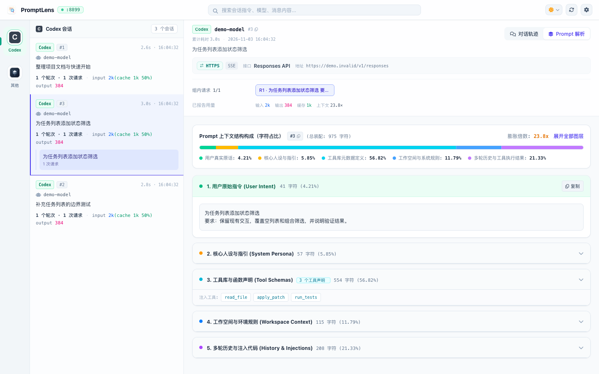

<p align="center">
  
</p>

<h1 align="center">PromptLens</h1>

<p align="center">
  <strong>Demystify Every Model Request and Prompt Assembly in Coding Agents</strong><br />
  A truly non-intrusive local network audit and prompt anatomy research platform
</p>

<p align="center">
  <a href="LICENSE">MIT License</a> ·
  <a href="docs/SUPPORT.md">Platform Support</a> ·
  <a href="docs/SECURITY_MODEL.md">Local Security Model</a> ·
  <a href="AGENTS.md">Agent Dev Guide</a> ·
  <a href="README.md">中文说明</a>
</p>

<p align="center">
  <picture>
    <source media="(prefers-color-scheme: dark)" srcset="docs/assets/promptlens-anatomy-dark.png" />
    
  </picture>
</p>

<p align="center"><sub>Live application screenshot · Synthetic sample data, not live model calls · <a href="docs/assets/README.md">Screenshot Notes</a></sub></p>

---

## Introduction

**PromptLens** is a high-performance, lightweight local request auditing and prompt anatomy tool tailored for modern Coding Agents.

Contemporary AI programming assistants (such as Antigravity, Codex, Pi, WorkBuddy, Cursor, etc.) construct sophisticated prompt pipelines behind the scenes—injecting system directives, workspace context, historical conversation slices, tool definitions, and multi-turn state. PromptLens observes and dissects every interaction via an explicit local HTTP/HTTPS/WebSocket proxy with zero latency disruption to business traffic:

- **Prompt Anatomy**: Intelligently decomposes prompts spanning tens of thousands of tokens into clear layers: System Prompts, real user inputs, workspace file tree context, code references, and tool invocation returns.
- **Session & Turn Clustering**: Automatically aggregates discrete HTTP/WS network frames into native Sessions and interaction Turns based on protocol contracts and client fingerprints, distinguishing user turns from background warmup, title generation, or search tasks.
- **Authentic Token Tracking**: Never estimates token counts using character heuristics. PromptLens strictly relies on reported usage explicitly provided by protocol responses, accurately recording real costs per turn and per model.
- **Local-First & Privacy Compliant**: All audit records are stored locally in an embedded SQLite database. Sensitive headers (`Authorization`, `Cookie`, `API Key`) are automatically redacted. Root certificates decrypt local controlled traffic only; no data is ever sent to remote cloud telemetry.

---

## Supported Agent Matrix

| Agent Entry | Supported Modes | Attribution Features |
| --- | --- | --- |
| **Antigravity** | One-click Desktop Launch / Terminal Command | Native `cascade_id` session clustering, Explicit Input turn grouping, WebSearch attribution |
| **Codex** | One-click Desktop Launch / CLI Command | `thread_id` & `turn_id` attribution, product turn grouping, warmup & memory task detection |
| **WorkBuddy** | One-click Desktop Launch / Terminal Command | Verified Client identity, wrapped query extraction, and prompt anatomy |
| **Pi Agent** | Terminal Command Launch | Native session-backed request attribution and ancestor-chained turn boundaries |
| **General Terminal / Cursor** | Environment Variable Injection | General HTTP/HTTPS proxy and Node/Curl/Python CA certificate environment auto-injection |

---

## Getting Started

### Prerequisites

- **OS**: macOS (Apple Silicon recommended; Intel macOS supported for experimental source builds; Linux supported for automated testing/dev)
- **Toolchain**: Node.js **22.20.0**+, npm, Go **1.27.3**+, Git, OpenSSL, Xcode Command Line Tools

### Building & Running from Source

```bash
# 1. Clone the repository
git clone https://github.com/wiseqingyang/prompt-lens.git
cd prompt-lens

# 2. Install dependencies and run full verification gates
npm ci
npm run verify

# 3. Build and launch the desktop application
npm start
```

### Usage Workflow

1. **Open Settings**: Launch the application and click the settings gear icon in the header.
2. **Install Root CA**: Under the "Privacy" tab, verify the HTTPS root certificate status and click "Install & Trust Certificate…" to allow local decryption of controlled traffic.
3. **Launch with Proxy**:
   - **One-click Launch**: Select your desired application under the "Agent Guide" tab (e.g., Codex or Antigravity) and click "Launch". If the app is already running, a clean confirmation dialog will prompt you to restart it with proxy mounting.
   - **Terminal Injection**: Copy the generated shell snippet and paste it into your terminal session to launch CLI agents with proxy environments.
4. **Real-time Observation**: Conduct coding tasks in your Agent. Switch back to PromptLens to view real-time conversation flows, context decomposition, and detailed token consumption heatmaps.

---

## Secondary Development & Agent Collaboration

PromptLens is built with an agent-friendly, contract-driven architecture. Comprehensive guidelines are provided for both human contributors and AI programming agents:

- 🤖 **[AGENTS.md](AGENTS.md) (Agent Development Guidelines)**: Essential reading for coding agents, detailing codebase rules, safety principles, architectural maps, and development workflows.
- 📐 **[Architecture Overview (docs/ARCHITECTURE.md)](docs/ARCHITECTURE.md)**: In-depth documentation covering Go Core, Electron Main, SQLite Storage, and Vue 3 Renderer layers.
- 🔌 **[Agent Adaptation Guide (docs/AGENT_ADAPTATION.md)](docs/AGENT_ADAPTATION.md)**: Standard operating procedure for defining identity, purpose, session clustering, and turn boundaries for new agents.
- 🛠 **[Development & Acceptance Process (docs/DEVELOPMENT.md)](docs/DEVELOPMENT.md)**: End-to-end contribution workflow; see [docs/requirements/TEMPLATE.md](docs/requirements/TEMPLATE.md) for requirement templates.
- 🧪 **[Testing Guidelines (tests/AGENTS.md)](tests/AGENTS.md)**: Guidelines for isolated testing with random ports, synthetic fixtures, and deterministic teardown.

### Useful Development Commands

```bash
npm run verify:fast       # Quick typecheck and static analysis (~3s)
npm run verify            # Full pre-delivery verification (Go race + 365+ Node contract tests + build)
npm run check:source      # Verify source allowlist integrity (source-files.json)
npm run audit:dependencies# Audit dependencies for 0 prod vulnerabilities and Go security
npm run pack:source       # Build clean release-grade source archive and sha256 checksums
```

---

## Open Source Standards & Policies

- **License**: Released under the [MIT License](LICENSE).
- **Security Policy**: Read [SECURITY.md](SECURITY.md) and the [Local Security Model (docs/SECURITY_MODEL.md)](docs/SECURITY_MODEL.md). Report vulnerabilities responsibly through private channels.
- **Contributing**: Contributions are welcome! Please review [CONTRIBUTING.md](CONTRIBUTING.md).
- **Code of Conduct**: This project adheres to [CODE_OF_CONDUCT.md](CODE_OF_CONDUCT.md).
- **Uninstall & Recovery**: For complete removal or certificate revocation instructions, see the [Uninstall & Network Recovery Guide (docs/UNINSTALL.md)](docs/UNINSTALL.md).
- **Third-Party Notices**: Attribution and third-party license details are maintained in [THIRD_PARTY_NOTICES.md](THIRD_PARTY_NOTICES.md). PromptLens has no official affiliation or endorsement with any commercial Agent vendors mentioned.
