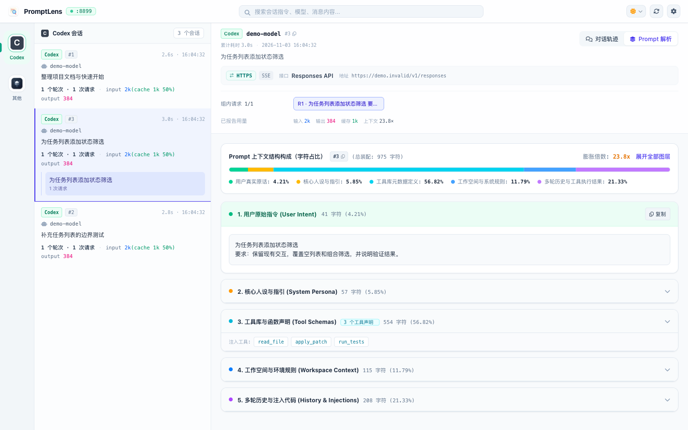

<p align="center">
  
</p>

<h1 align="center">PromptLens</h1>

<p align="center">
  <strong>看清 Coding Agent 的每一次模型请求与提示词组装</strong><br />
  真正无侵入式的 Coding Agent 本地网络审计与提示词解剖研究平台
</p>

<p align="center">
  <a href="LICENSE">MIT License</a> ·
  <a href="docs/SUPPORT.md">支持平台</a> ·
  <a href="docs/SECURITY_MODEL.md">本地安全模型</a> ·
  <a href="AGENTS.md">Agent 开发指引</a> ·
  <a href="README.en.md">English</a>
</p>

<p align="center">
  <picture>
    <source media="(prefers-color-scheme: dark)" srcset="docs/assets/promptlens-anatomy-dark.png" />
    
  </picture>
</p>

<p align="center"><sub>实际应用界面 · 合成演示数据，非真实模型调用 · <a href="docs/assets/README.md">截图说明</a></sub></p>

---

## 项目简介

**PromptLens** 是一个运行在本机的高性能、轻量级 Coding Agent 请求审计与提示词解剖工具。

现代 AI 编程助手（如 Antigravity、Codex、Pi、WorkBuddy、Cursor 等）在后台构建了极其复杂的提示词管道（注入系统约定、项目上下文、历史对话切片、工具定义以及多轮交互状态）。PromptLens 通过本地显式配置的透明 HTTP/HTTPS/WebSocket 代理，在零时延干扰业务的前提下，完整观察并结构化解剖每一次大模型交互：

- **提示词组成解剖 (Prompt Anatomy)**：智能剥离长达上万 Token 的上下文，清晰透视 System Prompt、用户真实指令、文件树注入、代码引用与工具返回结果。
- **会话与轮次聚类 (Session & Turn Clustering)**：基于协议契约与客户端特征，将离散的网络请求自动聚合到原生对话（Session）与交互轮次（Turn）中，自动识别预热请求、辅助任务与后台搜索。
- **真实 Token 精确溯源**：拒绝基于字符数的本地估算，严格采信协议显式返回的 reported usage，准确记录每轮交互与各个模型的真实消耗。
- **本地优先与隐私合规**：所有审计记录落盘本机 SQLite 数据库；认证请求头（Authorization、Cookie、API Key）自动脱敏；根证书仅用于本机受控流量；不设置任何远程云端上报。

---

## 支持的 Agent 矩阵

| Agent 接入项 | 支持模式 | 归属特性 |
| --- | --- | --- |
| **Antigravity** | 桌面端一键启动 / 终端命令 | 原生 `cascade_id` 会话聚类、Explicit Input 轮次划分、WebSearch 关联 |
| **Codex** | 桌面端一键启动 / CLI 命令 | `thread_id` 与 `turn_id` 原生归属、产品级轮次聚合、预热/记忆任务识别 |
| **WorkBuddy** | 桌面端一键启动 / 终端命令 | Client 身份确认、包装查询提取与上下文解剖 |
| **Pi Agent** | 终端命令启动 | 基于原生 Session 记录的请求归属与祖先链分轮 |
| **通用终端 / Cursor** | 环境变量注入 | 通用 HTTP/HTTPS 代理与 Node/Curl/Python 证书环境自动配置 |

---

## 快速开始

### 环境依赖

- **操作系统**：macOS (Apple Silicon 推荐；Intel 支持实验性源码编译；Linux 适合自动化测试与开发)
- **开发工具**：Node.js **22.20.0**+、npm、Go **1.27.3**+、Git、OpenSSL、Xcode Command Line Tools

### 从源码运行

```bash
# 1. 克隆仓库
git clone https://github.com/wiseqingyang/prompt-lens.git
cd prompt-lens

# 2. 安装依赖并执行本地质量门禁验证
npm ci
npm run verify

# 3. 编译并启动桌面应用
npm start
```

### 接入与使用流程

1. **打开设置**：启动应用后点击顶部齿轮进入「设置中心」。
2. **信任根证书**：在「隐私」页检查 HTTPS 根证书状态，点击「安装并信任证书…」以便本机解密受控流量。
3. **挂载代理与启动**：
   - **一键启动**：在「Agent 接入」页面选择对应的应用（如 Codex 或 Antigravity），点击「启动」即可自动注入代理与 CA 环境变量运行。若应用已在运行，将弹出极简提示确认是否重启以挂载代理。
   - **终端启动**：复制对应的终端命令，在个人终端中粘贴运行即可为该终端进程配置代理。
4. **实时观测**：在 Agent 中执行代码编写任务，返回 PromptLens 即可实时查看会话流、提示词上下文解剖与详细 Token 统计。

---

## 二次开发与 Agent 协同

PromptLens 采用规范化、契约化架构设计，对人类开发者与 AI 编程 Agent 均提供清晰的指引：

- 🤖 **[AGENTS.md](AGENTS.md)（Agent 协同开发总则）**：包含全仓开发铁律、核心契约、模块地图与标准工作流程，建议参与代码编写的 Agent 优先通读。
- 📐 **[系统架构与代码入口 (docs/ARCHITECTURE.md)](docs/ARCHITECTURE.md)**：深入了解 Go 核心代理、Electron 主进程、SQLite 存储及 Vue 3 渲染端的分工。
- 🔌 **[新增 Agent 适配指南 (docs/AGENT_ADAPTATION.md)](docs/AGENT_ADAPTATION.md)**：包含如何为新 Agent 定义身份识别、用途分类、会话聚类与轮次边界的标准规范。
- 🛠 **[开发流程与验收标准 (docs/DEVELOPMENT.md)](docs/DEVELOPMENT.md)**：从需求到交付的完整闭环，过程性需求文档模板参考 [docs/requirements/TEMPLATE.md](docs/requirements/TEMPLATE.md)。
- 🧪 **[测试约束与隔离原则 (tests/AGENTS.md)](tests/AGENTS.md)**：使用随机端口、合成数据与临时目录保障测试独立性的最佳实践。

### 常用开发命令

```bash
npm run verify:fast       # 快速类型与静态语法检查 (~3s)
npm run verify            # 交付前全量质量门禁（含 Go race 与全套 Node 契约回归）
npm run check:source      # 检查公开文件白名单 (source-files.json)
npm run audit:dependencies# 执行生产零漏洞审计与 Go 漏洞扫描
npm run pack:source       # 验证并构建发布级源码归档与校验和
```

---

## 开源协议与标准声明

- **开源协议**：本项目基于 [MIT License](LICENSE) 开源发布。
- **安全政策**：请阅读 [SECURITY.md](SECURITY.md) 及 [本地安全与隐私模型 (docs/SECURITY_MODEL.md)](docs/SECURITY_MODEL.md)；安全漏洞请通过 GitHub 私密通道反馈，切勿公开包含真实凭据的报文。
- **贡献指南**：欢迎提交 Pull Request，详情参见 [CONTRIBUTING.md](CONTRIBUTING.md)。
- **社区行为准则**：本项目遵循 [CODE_OF_CONDUCT.md](CODE_OF_CONDUCT.md)。
- **卸载与系统恢复**：若需卸载应用或撤销证书信任，请参阅 [卸载与恢复指南 (docs/UNINSTALL.md)](docs/UNINSTALL.md)。
- **第三方致谢**：第三方开源依赖项及证书归属清单详见 [THIRD_PARTY_NOTICES.md](THIRD_PARTY_NOTICES.md)。PromptLens 与文中所提及的任何商业 Agent 厂商均无隶属或背书关系。
